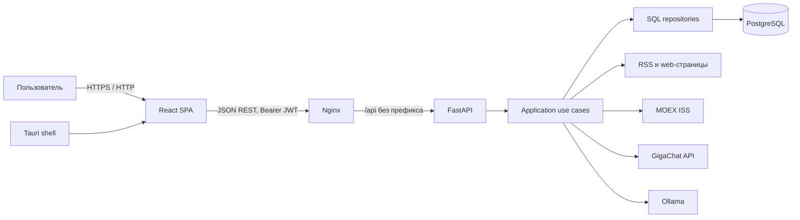
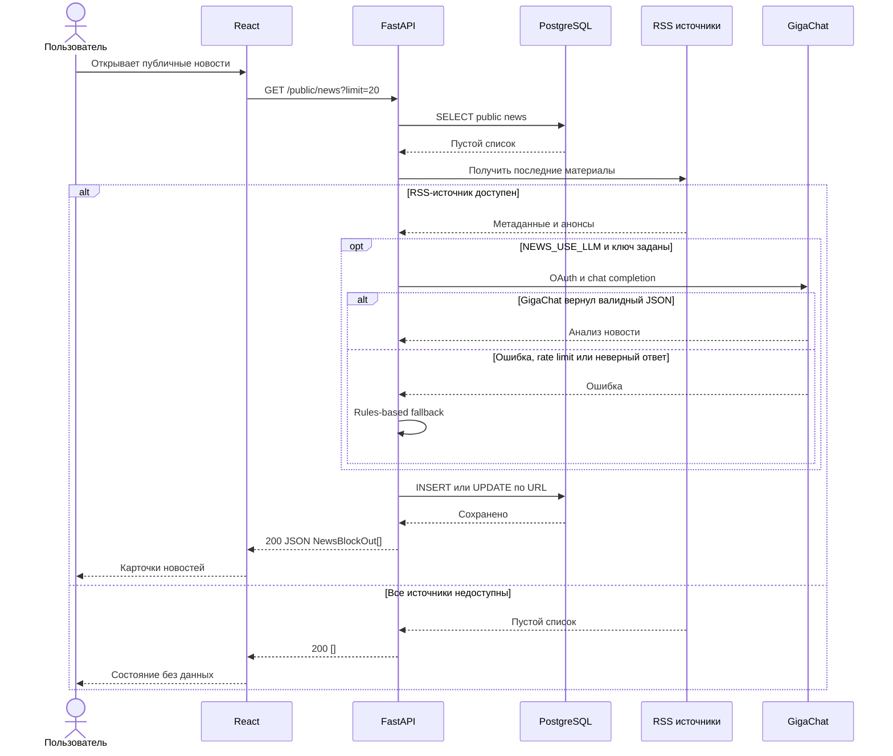

# Архитектура FinPulse

Документ фиксирует **AS-IS** по исходному коду. Требования и известные расхождения: [requirements.md](requirements.md).

## Общий контур

Основной стиль — клиент-серверная архитектура: браузер отвечает за представление и пользовательское состояние, FastAPI централизует валидацию, права и бизнес-правила, PostgreSQL обеспечивает постоянное хранение. Это не микросервисная система: backend развёртывается одним приложением, хотя код разделён на presentation/application/domain/infrastructure.

## Компоненты и ответственность

| Компонент | AS-IS ответственность |
|---|---|
| React / TypeScript | Маршрутизация, формы, отображение новостей/котировок/чата, хранение JWT в `localStorage`, refresh/retry через Axios, UI-guards по permissions |
| Nginx | Раздача собранной SPA, fallback на `index.html`, reverse proxy `/api/*` к backend |
| FastAPI presentation | REST-маршруты, Pydantic-валидация, dependency injection, HTTP-коды, CORS и middleware |
| Application use cases | Получение/анализ лент, построение chat prompt, правила качества LLM-ответа, auth workflows |
| Infrastructure | SQLAlchemy repositories, JWT/RBAC, RSS/scraping, MOEX, GigaChat, Ollama |
| PostgreSQL | Пользователи и профиль, refresh tokens, RBAC, чаты, news/cache payload |
| Scheduler | Фоновое периодическое обновление публичной ленты в процессе backend |
| Docker Compose | `frontend`, `backend`, `db`, `ollama`, одноразовый `ollama-init`; volumes `pgdata`, `ollama` |

Tauri оборачивает тот же frontend и не создаёт отдельный backend-контур.

## Где выполняется логика и работа с данными

- Входные ограничения задают Pydantic schemas и FastAPI `Query`.
- Авторизация и RBAC выполняются dependencies до обработчика.
- Оркестрация RSS, кэша, LLM/fallback и персонализации находится в application use cases.
- SQL сосредоточен в repositories; ORM-модели находятся в infrastructure.
- Новостной анализ хранится как сериализованный JSON в `payload_json`; отдельной нормализованной таблицы фактов/рисков нет.
- GigaChat используется backend для новостей, Ollama — для чата. Браузер не обращается к ним напрямую.

## Основные потоки данных

### Публичная лента

Backend сначала читает `news`. При пустой витрине синхронно получает RSS, при непустой — возвращает сохранённое и запускает обновление в фоне. Текст может дополняться scraper; GigaChat включается конфигурацией, а при ошибке применяется rules-based анализ. URL новости уникален в БД.

### Персональная лента

Профиль пользователя определяет контекст и категории. `GetNewsFeed` использует RSS, `news_cache`, GigaChat/rules и сохраняет публичные результаты в `news`.

### Чат

Backend строит prompt из профиля и последних сообщений, обращается к локальному Ollama, проверяет ответ и сохраняет обе стороны диалога. AS-IS параметр `chat_id` клиента не переключает сессию: используется default chat.

### Котировки

Backend запрашивает MOEX ISS для фиксированной выборки тикеров IMOEX. При сетевой/форматной ошибке возвращает тот же response model с `fallback=true`.

## Sequence Diagram — холодный старт публичной ленты

## Docker-контур и эксплуатационные ограничения

Development override публикует frontend на `3000` и backend на `8000`; production override публикует только Nginx на `80`. Backend ждёт health PostgreSQL и Ollama, а также завершение загрузки модели `ollama-init`. Схема БД создаётся при startup через `create_all`; версионированных миграций нет — это [GAP-01](requirements.md#11-ограничения-и-gap).

## Связанные документы

[API](api.md) · [Модель данных](data-model.md) · [CI/CD](ci-cd.md)
