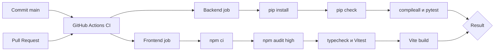
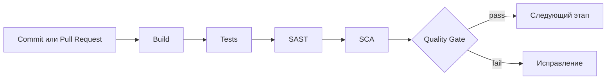

# CI/CD FinPulse

## 1. Что такое CI в контексте FinPulse

CI — автоматическая проверка backend и frontend для каждого изменения. Workflow `.github/workflows/ci.yml` устанавливает зависимости в чистой GitHub-hosted среде, запускает проверки и формирует единый PASS/FAIL. Автоматического deployment (**CD**) AS-IS нет.

## 2. События запуска

- `push` в ветку `main`;
- любой `pull_request`.

Workflow имеет только permission `contents: read` и не изменяет репозиторий.

## 3. Jobs

Два независимых job выполняются параллельно:

| Job | Runtime | Результат |
|---|---|---|
| `backend` | Python 3.11 | проверка зависимостей, compile check и 69 pytest tests из текущего набора |
| `frontend` | Node.js 20 | npm audit для high/critical, TypeScript, 9 Vitest tests и production Vite build |

Число тестов приведено по локальному прогону и может меняться.

## 4. Steps

Dependency cache использует `requirements.txt` и `package-lock.json`. `npm ci` обеспечивает соответствие lock-файлу.

## 5. Что происходит при падении

Ненулевой exit code шага завершает соответствующий job как FAIL. Итог workflow становится FAIL. Чтобы это реально запрещало merge, владелец GitHub-репозитория должен включить branch protection и выбрать оба status check как required — наличие YAML само по себе merge не блокирует.

## 6. Environment variables и secrets

Backend tests используют только явно тестовые значения в `env` workflow. PostgreSQL service не поднимается: integration tests заменяют repositories dependency overrides. GigaChat/Ollama не вызываются реальной сетью.

Production secrets в workflow отсутствуют. Если будущие отдельные integration tests потребуют GigaChat, ключ следует передавать как `${{ secrets.GIGACHAT_AUTH_KEY }}` и запускать такие проверки осознанно; текущему CI он не нужен.

## 7. Результат pipeline

Результат — статусы backend/frontend jobs и логи каждого шага. Артефакт deployment не создаётся. GitHub Actions run `32839010217` для commit `28e6c0d` успешно завершён 25 августа 2026 года; новые изменения должны проходить тот же workflow.

## 8. Возможное развитие

Возможный следующий шаг — запускать Playwright в CI, если проекту понадобится автоматическая браузерная проверка. Автоматический deployment текущему учебному MVP не нужен. Это TARGET/TODO, не AS-IS.

## Образовательный security-flow

SAST/SCA и Solar appScreener **не интегрированы** в текущий FinPulse. Схема показывает только место будущих AppSec-проверок. Контекст: [appsec-context.md](appsec-context.md).
