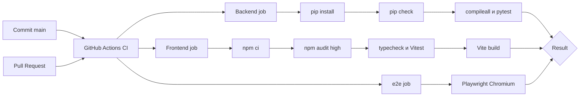

# CI/CD FinPulse

## 1. Что такое CI в контексте FinPulse

CI — автоматическая проверка backend и frontend для каждого изменения. Workflow `.github/workflows/ci.yml` устанавливает зависимости в чистой GitHub-hosted среде, запускает проверки и формирует единый PASS/FAIL. Автоматического deployment (**CD**) AS-IS нет.

## 2. События запуска

- `push` в ветку `main`;
- любой `pull_request`.

Workflow имеет только permission `contents: read` и не изменяет репозиторий.

## 3. Jobs

Три независимых job выполняются параллельно:

| Job | Runtime | Результат |
|---|---|---|
| `backend` | Python 3.11 | `pip check`, `compileall`, flake8, pytest и `pip-audit` зависимостей |
| `frontend` | Node.js 20 | npm audit для high/critical, TypeScript, Vitest и production Vite build |
| `e2e` | Node.js 20 + Chromium | изолированные Playwright-сценарии пользовательских потоков |

Число тестов приведено по локальному прогону и может меняться.

## 4. Steps

Dependency cache использует `requirements.txt` и `package-lock.json`. `npm ci` обеспечивает соответствие lock-файлу.

## 5. Что происходит при падении

Ненулевой exit code шага завершает соответствующий job как FAIL. Итог workflow становится FAIL. Чтобы это реально запрещало merge, владелец GitHub-репозитория должен включить branch protection и выбрать оба status check как required — наличие YAML само по себе merge не блокирует.

## 6. Environment variables и secrets

Backend tests используют только явно тестовые значения в `env` workflow. PostgreSQL service не поднимается: integration tests заменяют repositories dependency overrides. GigaChat/Ollama не вызываются реальной сетью.

Production secrets в workflow отсутствуют. Playwright подменяет ответы API через `page.route`, поэтому сценарии не требуют реальной базы, GigaChat или Ollama. Если будущие отдельные integration tests потребуют GigaChat, ключ следует передавать как `${{ secrets.GIGACHAT_AUTH_KEY }}` и запускать такие проверки осознанно; текущему CI он не нужен.

## 7. Результат pipeline

Результат — статусы backend/frontend/e2e jobs и логи каждого шага. Артефакт deployment не создаётся. YAML подготовлен для GitHub Actions; успешное выполнение на GitHub нужно подтверждать статусом конкретного workflow run.

## 8. Возможное развитие

Автоматический deployment текущему MVP не нужен. Следующий практический шаг — включить required checks в branch protection после первого успешного workflow run.
