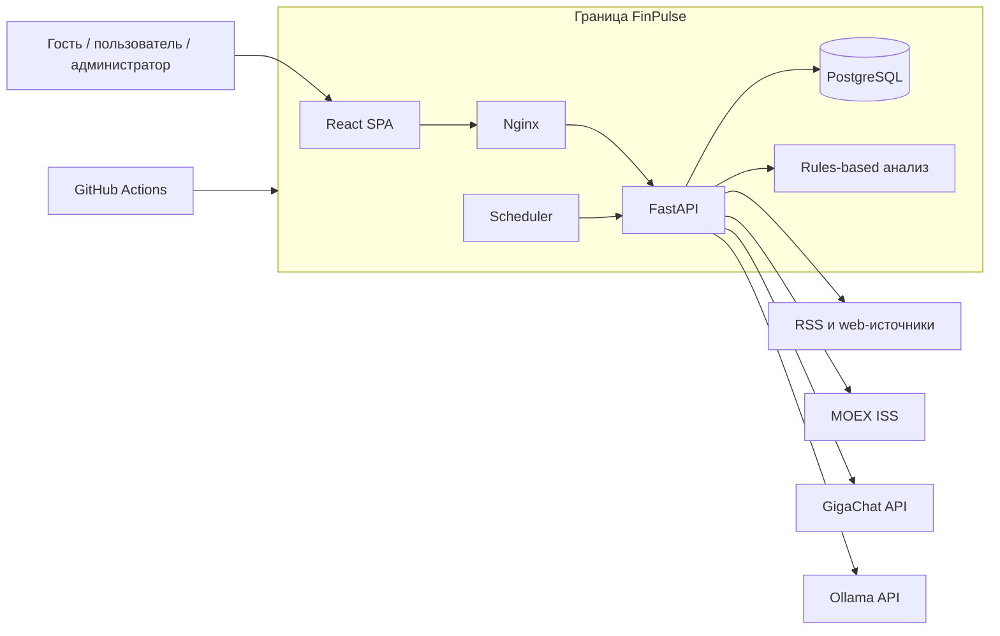

# Контекст FinPulse

Документ фиксирует контекст системы по состоянию **AS-IS**, подтверждённому кодом и конфигурацией репозитория. Возможное развитие отмечается как **TARGET**, известные расхождения — как **GAP**.

## 1. Назначение и проблема

FinPulse — информационный веб-сервис для российского фондового рынка. Он собирает финансовые новости из нескольких источников, приводит их к единому формату, показывает возможное влияние и риски, предоставляет выборку котировок MOEX и AI-чат.

Проблема пользователя: финансовая информация распределена между источниками, а чтение и первичная интерпретация большого количества материалов требуют времени.

FinPulse не проводит торговые операции, не управляет деньгами и не гарантирует прогноз. Его материалы не являются инвестиционной рекомендацией.

## 2. Цели

### Пользовательская цель

Быстро найти существенную финансовую информацию и получить понятное информационное объяснение новости или вопроса о российском рынке.

### Цель проекта

Создать работающий full-stack MVP с согласованными требованиями, API, моделью данных, интеграциями, тестированием и архитектурой.

## 3. Stakeholders и actors

**Stakeholder** — человек или организация, чьи интересы затрагивает система. **Actor** — роль или внешняя система, которая непосредственно взаимодействует с FinPulse.

| Участник | Тип | Интерес или взаимодействие |
|---|---|---|
| Владелец продукта | Stakeholder | Работоспособный, документированный и демонстрируемый MVP |
| Гость | Human actor | Просмотр публичных новостей и котировок, регистрация и вход |
| Зарегистрированный пользователь | Human actor | Профиль, персональная лента, AI-чат и история сообщений |
| Администратор | Human actor | Просмотр пользователей и назначение ролей |
| RSS-источники | External system actor | Передают метаданные и доступный текст новостей |
| MOEX ISS | External system actor | Передаёт рыночные котировки |
| GigaChat API | External system actor | Выполняет структурированный анализ новостей, если интеграция включена |
| Ollama | External system actor | Генерирует ответы пользовательского чата |
| GitHub Actions | Supporting external system | Запускает проверки изменений репозитория |

Основным actor продукта считается пользователь финансовой информации. В зависимости от наличия учётной записи он взаимодействует с системой как гость или зарегистрированный пользователь.

## 4. System boundary

Внутри границы FinPulse находятся:

- React/TypeScript frontend и его Tauri-оболочка;
- Nginx reverse proxy;
- FastAPI backend;
- application use cases и rules-based анализ;
- SQLAlchemy repositories;
- PostgreSQL и данные FinPulse;
- scheduler обновления публичной ленты;
- конфигурация Docker Compose и CI workflow репозитория.

За границей системы находятся пользовательский браузер, RSS/web-источники, MOEX ISS, GigaChat API, инфраструктура Ollama и GitHub-hosted CI runner. Ollama запускается тем же Docker Compose, но с точки зрения backend остаётся отдельной системой с собственным API и возможностью отказа.

## 5. Scope AS-IS

- публичная лента и карточка финансовой новости;
- получение и фильтрация материалов из RSS/web-источников;
- GigaChat-анализ с rules-based fallback;
- публичная выборка котировок MOEX с fallback-ответом;
- регистрация, JWT-аутентификация, refresh/logout;
- роли и permissions;
- инвестиционный профиль пользователя;
- персональная новостная лента;
- AI-чат через Ollama и хранение его истории;
- административное управление ролями;
- PostgreSQL, Docker Compose, Tauri и CI-проверки.

## 6. Out of scope AS-IS

- брокерский счёт, биржевые заявки, платежи и управление реальными средствами;
- гарантированные прогнозы и персональные инвестиционные рекомендации;
- обучение собственной LLM или ML-модели;
- production deployment, Kubernetes и облачная инфраструктура;
- push-уведомления и биллинг;
- мобильное приложение;
- специализированные сканеры безопасности кода.

## 7. Ограничения

- качество анализа зависит от полноты исходного материала и ответа модели;
- публичные источники и внешние API могут быть недоступны или изменить контракт;
- GigaChat используется только при включённой конфигурации и наличии credentials;
- чат зависит от доступности локальной модели Ollama;
- FinPulse ориентирован на российский рынок, профиль использует рынок `RU`;
- приложение является MVP, а не production-ready финансовой системой;
- автоматический deployment и формальный SLA отсутствуют;
- схема БД не имеет версионированных миграций.

## 8. AS-IS, TARGET и GAP

| Статус | Содержание |
|---|---|
| AS-IS | Компоненты, actors, интеграции и scope выше подтверждены репозиторием |
| TARGET | Добавить миграции и улучшить эксплуатационную надёжность |
| GAP | Нет Alembic и CD; refresh token хранится в БД открытым; часть API-контрактов описана неполно |

## 9. Связанные документы

- [Требования](requirements.md)
- [Use Cases](use-cases.md)
- [Архитектура](architecture.md)
- [REST API](api.md)
- [Модель данных](data-model.md)
