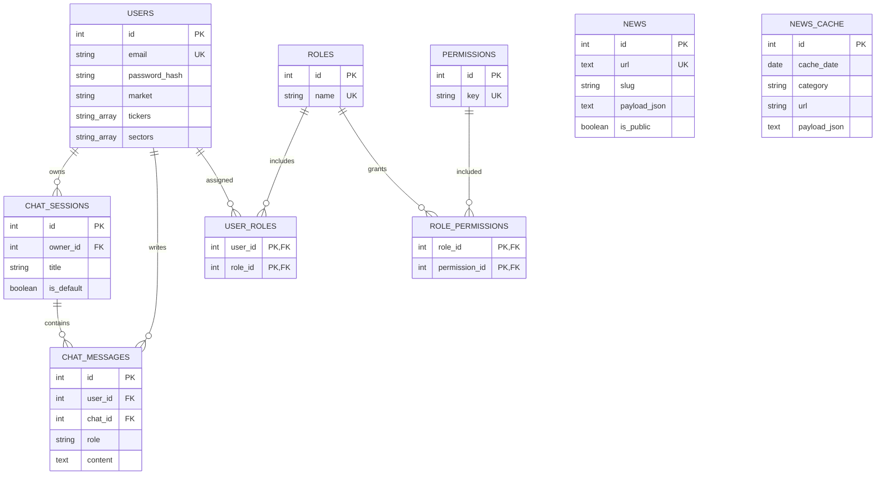

# Модель данных

Источник истины: `backend/app/infrastructure/database/models.py` и startup seed. Схема предназначена для PostgreSQL: используются `ARRAY`, timezone timestamps и PostgreSQL-ориентированные запросы.

## ER-диаграмма AS-IS

`news` и `news_cache` не имеют FK к пользователю: это общая витрина и дневной кэш. Между ними также нет физической связи.

## Сущности и поля

Обозначения: **NN** — `NOT NULL`, **NULL** — допускает `NULL`, **SD** — server default.

### `users`

| Поле | Тип | Ограничения | Назначение |
|---|---|---|---|
| `id` | integer | PK | Идентификатор |
| `name` | varchar | NN | Имя |
| `email` | varchar | NN, UNIQUE, index | Логин |
| `password_hash` | varchar | NN | Хеш пароля |
| `market` | varchar | NN, SD `RU` | Рынок профиля |
| `investment_horizon` | varchar | NULL | `short/mid/long`, контролируется API |
| `experience_level` | varchar | NULL | `beginner/intermediate/pro` |
| `risk_level` | varchar | NULL | `low/medium/high` |
| `tickers` | varchar[] | NN, SD `{}` | Интересующие тикеры |
| `sectors` | varchar[] | NN, SD `{}` | Интересующие секторы |
| `refresh_token` | varchar | NULL | Текущий refresh JWT AS-IS |
| `refresh_token_expires_at` | timestamp | NULL | Срок refresh JWT |
| `created_at` | timestamptz | NN, SD now | Дата создания |

### `chat_sessions`

`id` integer PK; `owner_id` integer NN FK → `users.id` `ON DELETE CASCADE`, index; `title` varchar(120) NN; `topic` varchar(120) NULL; `is_default` boolean NN SD false; `created_at`, `updated_at` timestamptz NN SD now. Уникальное ограничение «один default на пользователя» в БД отсутствует.

### `chat_messages`

`id` integer PK; `user_id` integer NN FK → `users.id` cascade; `chat_id` integer NN FK → `chat_sessions.id` cascade, index; `role` varchar(20) NN с CHECK `user` или `FinPulse`; `content` text NN; `timestamp` timestamptz NN SD now.

### `news`

`id` integer PK; `title` varchar(512) NN; `slug` varchar(512) NN, index; `source` varchar(256) NN; `url` text NN UNIQUE; `asof` date NULL; `market`, `category` varchar(64) NULL; `payload_json` text NN; `is_public` boolean NN SD true; `created_at`, `updated_at` timestamptz NN. Индекс `(is_public, created_at)`; slug не уникален.

### `news_cache`

`id` integer PK; `cache_date` date NN; `market`, `category`, `url`, `source`, `title` varchar NN; `payload_json` text NN; timestamps NN. UNIQUE `(cache_date, category, url)`.

### RBAC

- `roles`: `id` PK, `name` NN UNIQUE; seed: `user`, `pro`, `admin`.
- `permissions`: `id` PK, `key` NN UNIQUE.
- `user_roles`: составной PK и UNIQUE `(user_id, role_id)`, оба FK с cascade.
- `role_permissions`: составной PK и UNIQUE `(role_id, permission_id)`, оба FK с cascade.

## Целостность и жизненный цикл

SQLAlchemy repositories открывают короткие сессии на операцию. Chat и RBAC-зависимости удаляются каскадно. Допустимые значения профиля проверяются Pydantic, но не закреплены DB CHECK-ограничениями. Payload анализа хранится JSON-строкой, поэтому его структура контролируется приложением, не PostgreSQL JSON schema.

## GAP

- `seed_rbac.ensure_user_subscription_column()` добавляет физическую колонку `users.subscription_tier`, но ORM `UserModel` её не описывает и приложение не использует.
- Alembic/migrations отсутствуют; `create_all` не управляет эволюцией существующих колонок.
- Нет DB-ограничения на единственную default chat session владельца.
- Refresh token хранится в открытом виде; компрометация БД позволяет использовать его до истечения/отзыва.
- В проверенном persistent Docker volume осталась таблица `files` (9 полей, включая `owner_id`, `chat_id`, `object_key`), которой нет в текущих ORM-моделях и API. Это след прежней версии схемы, а не функция текущего MVP.

Связанные документы: [архитектура](architecture.md), [API](api.md), [требования](requirements.md).
